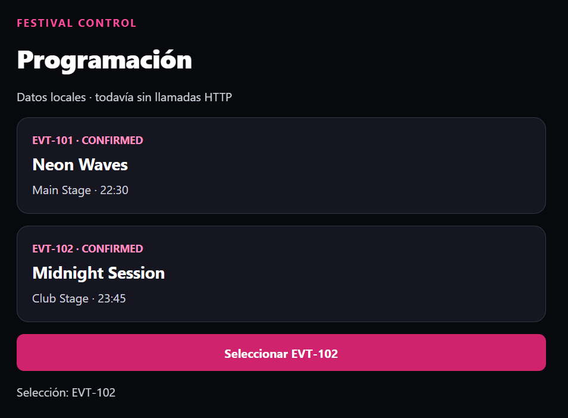
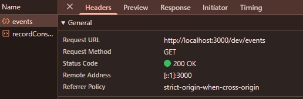
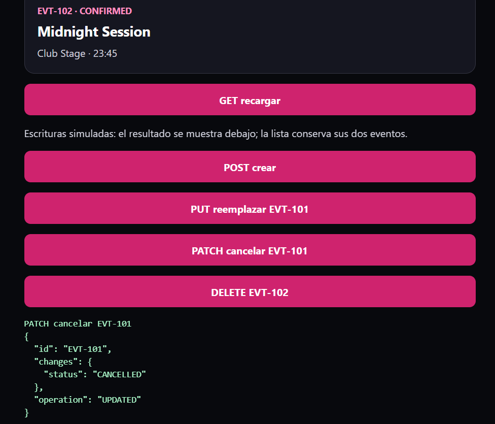
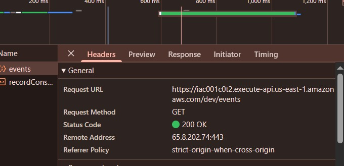
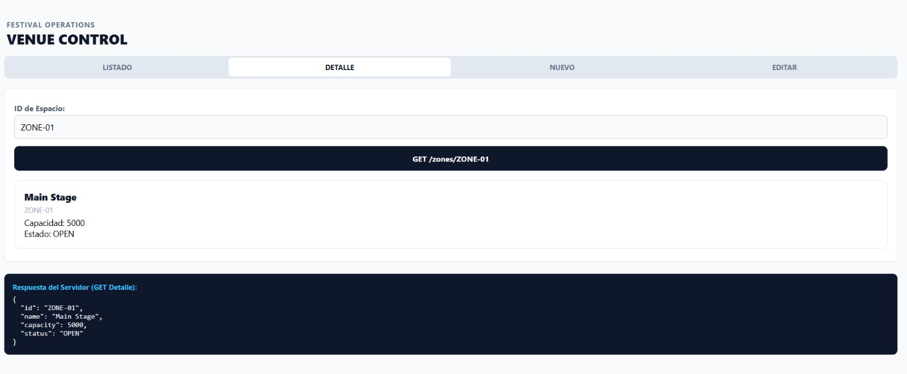

# Festival Control · Bloque 01
 
## Qué he construido
He creado una función serverless básica con TypeScript en `src/hello.ts` y he probado en local la ruta GET `/hello`.

## Qué he comprendido
El handler usa tipos para controlar el evento de entrada y la respuesta HTTP. Al compilar con `tsc`, pasa de TypeScript a `dist/hello.js`, y el mensaje "EVENT RECIBIDO" sale en los logs de la terminal cada vez que entra una petición.

## Qué he modificado
He cambiado el mensaje que devuelve el body del JSON en la respuesta. La URL sigue siendo `/hello` porque no he tocado la ruta en la configuración del servidor, solo el contenido devuelto.

## Cómo lo he comprobado
Hice peticiones GET desde Thunder Client y con `curl`, recibiendo un 200 OK con el nuevo JSON y viendo reflejado el log en la consola.


# Bloque 02

## Resultado
- Qué añadí al proyecto: Creé el handler `backend/src/getEvent.ts` y configuré la nueva ruta con parámetro en `backend/serverless.yml`.
- Ruta o pantalla comprobada: La ruta GET `/events/{id}` (probando con dos ids distintos) y comprobé que `/hello` sigue funcionando.
- Estado y respuesta observados: Estado 200 OK con el JSON devolviendo los datos simulados del evento según el id pasado en la URL.
- Recorrido del dato, explicado con mis palabras: El id que pongo en la URL viaja en la petición HTTP y Serverless lo mete en `event.pathParameters.id`, de donde el handler lo lee para generar la respuesta.
- Cambio guiado y resultado: Probé a cambiar el id en la URL para ver que el mismo handler procesa identificadores diferentes sin tener que crear rutas nuevas.
- Error encontrado y cómo lo resolví: Al principio `pathParameters` venía como opcional en TypeScript, así que me aseguré de comprobar que existía antes de leer el id para evitar fallos de tipado.

## Evidencias
$ curl -i http://localhost:3000/dev/events/EVT-330
HTTP/1.1 200 OK
content-type: application/json; charset=utf-8
vary: origin
access-control-expose-headers: WWW-Authenticate,Server-Authorization
cache-control: no-cache
content-length: 95
accept-ranges: bytes
Date: Tue, 27 Oct 2026 09:31:48 GMT
Connection: keep-alive
Keep-Alive: timeout=5

{"id":"EVT-330","artist":"Neon Waves","space":"Main Stage","time":"22:30","status":"CONFIRMED"}


## Bloque 03

## Resultado
- Qué añadí al proyecto: Creé el nuevo handler `backend/src/createEvent.ts` y di de alta el endpoint con método `POST` en `backend/serverless.yml`.
- Ruta o pantalla comprobada: La ruta POST `/events` enviando un objeto JSON en el cuerpo de la petición.
- Estado y respuesta observados: Estado 201 Created (o 200 OK) devolviendo el objeto del evento creado junto con su id asignado o confirmación.

## Comprensión
- Recorrido del dato, explicado con mis palabras: El cliente envía un JSON en el body de la petición HTTP; Serverless lo recibe como string en `event.body`, lo parseamos con `JSON.parse()` en TypeScript y procesamos los campos antes de responder.
- Cambio guiado y resultado: Modifiqué las propiedades enviadas en el cuerpo (como el nombre o fecha del evento) y comprobé que la función las recibe y devuelve correctamente en la respuesta.
- Error encontrado y cómo lo resolví: Si se envía la petición sin body o con JSON mal formateado, `JSON.parse` falla; se soluciona validando que `event.body` exista antes de parsear o envolviéndolo en un try/catch.

## Evidencias
$ curl -i -X POST http://localhost:3000/dev/events -H 'Content-Type: application/json' -d '{"artist":"Nova Pulse","space":"Main Stage","time":"21:00","status":"CANCELLED"}'
HTTP/1.1 201 Created
content-type: application/json; charset=utf-8
vary: origin
access-control-expose-headers: WWW-Authenticate,Server-Authorization
cache-control: no-cache
content-length: 95
Date: Tue, 27 Oct 2026 11:40:31 GMT
Connection: keep-alive
Keep-Alive: timeout=5

{"id":"EVT-NEW","artist":"Nova Pulse","space":"Main Stage","time":"21:00","status":"CANCELLED"}


# Bloque 04

## Resultado
- Qué añadí al proyecto: Handlers CRUD para los métodos sobre `/events` y `/events/{id}`, además del módulo compartido `model.ts` con tipos y catálogo fijo.
- Ruta o pantalla comprobada: Endpoint `/events/EVT-101` mediante PUT, PATCH y GET posterior.
- Estado y respuesta observados: PUT devolvió 400 Bad Request; PATCH devolvió 200 OK (`operation: UPDATED`); y el GET posterior devolvió 200 OK manteniendo el status `CONFIRMED`.

## Comprensión
- Recorrido del dato, explicado con mis palabras: La petición entra al handler según el método HTTP; PUT valida que llegue el objeto completo y falla al faltar campos, mientras que PATCH solo exige el campo a modificar y responde éxito sin alterar la memoria.
- Cambio guiado y resultado: Envié solo `{"status": "CANCELLED"}` por PUT (obteniendo 400) y por PATCH (obteniendo 200). Al consultar de nuevo con GET sigue saliendo `CONFIRMED` porque el ejercicio no tiene base de datos persistente.
- Error encontrado y cómo lo resolví: Al hacer PUT parcial el handler rechazó la petición por falta de campos obligatorios; lo resolví verificando que para sustitución completa se debe enviar la estructura entera del evento.

## Evidencias
- Captura o transcripción breve, sin credenciales:

## Evidencias
- Captura o transcripción breve, sin credenciales:
  ```bash
  # 1. PUT 
$ curl -i -X PUT http://localhost:3000/dev/events/EVT-101 \
  -H "Content-Type: application/json" \
  -d '{"status":"CANCELLED"}'
HTTP/1.1 400 Bad Request
content-type: application/json; charset=utf-8
vary: origin
access-control-expose-headers: WWW-Authenticate,Server-Authorization
cache-control: no-cache
content-length: 69
Date: Tue, 27 Oct 2026 18:14:42 GMT
Connection: keep-alive
Keep-Alive: timeout=5

{"message":"PUT requiere artist, space, time HH:mm y status válido"}

  # 2. PATCH parcial -> 200
  $ curl -i -X PATCH http://localhost:3000/dev/events/EVT-101 \
  -H "Content-Type: application/json" \
  -d '{"status":"CANCELLED"}'
HTTP/1.1 200 OK
content-type: application/json; charset=utf-8
vary: origin
access-control-expose-headers: WWW-Authenticate,Server-Authorization
cache-control: no-cache
content-length: 71
Date: Tue, 27 Oct 2026 18:14:10 GMT
Connection: keep-alive
Keep-Alive: timeout=5

{"id":"EVT-101","changes":{"status":"CANCELLED"},"operation":"UPDATED"}

  # 3. GET comprobación
$ curl -i -X GET http://localhost:3000/dev/events/EVT-101
HTTP/1.1 200 OK
content-type: application/json; charset=utf-8
vary: origin
access-control-expose-headers: WWW-Authenticate,Server-Authorization
cache-control: no-cache
content-length: 95
accept-ranges: bytes
Date: Tue, 27 Oct 2026 18:15:18 GMT
Connection: keep-alive
Keep-Alive: timeout=5

{"id":"EVT-101","artist":"Neon Waves","space":"Main Stage","time":"22:30","status":"CONFIRMED"}


# Bloque 05

## Resultado
- Qué añadí al proyecto: La aplicación frontend en la carpeta `mobile/` usando Expo y React Native con TypeScript (`App.tsx`).
- Ruta o pantalla comprobada: La interfaz web de Expo abierta en el navegador local (`http://localhost:8081`).
- Estado y respuesta observados: Se muestran las dos tarjetas de eventos y al pulsar el botón cambia dinámicamente el texto a `Selección: EVT-101` (y tras la prueba, a `EVT-102`).

## Comprensión
- Recorrido del dato, explicado con mis palabras: Los eventos se leen de un array local tipado en `App.tsx` y se pintan con `.map()`[cite: 12]; al hacer clic en el `Pressable`, se ejecuta el evento `onPress` llamando a `setSelected(...)`, lo que actualiza el estado con `useState` y fuerza un nuevo render en pantalla.
- Cambio guiado y resultado: Cambié el valor de `setSelected` a `'EVT-102'` y la etiqueta del botón a "Seleccionar EVT-102"; al pulsar en pantalla se actualizó a `Selección: EVT-102`, y después restauré a `EVT-101` para mantener el hito base.
- Error encontrado y cómo lo resolví: Al guardar el cambio en `App.tsx` había que verificar que el tipo del estado admitiera el id y restaurar el valor inicial para no romper el contrato del siguiente bloque.

## Evidencias



# Bloque 06

## Resultado
- Qué añadí al proyecto: Creé el módulo cliente `api.ts` con la función `getEvents()` usando `fetch`, e integré la carga asíncrona con `useEffect` y manejo de estados (carga, error y eventos) en la interfaz.
- Ruta o pantalla comprobada: La interfaz web de React Native en `http://localhost:8081` haciendo peticiones a `http://localhost:3000/dev/events`.
- Estado y respuesta observados: Petición HTTP GET con estado 200 OK en Network y renderizado dinámico de las dos tarjetas recibidas desde la API.

## Comprensión
- Recorrido del dato, explicado con mis palabras: Al montar el componente, `useEffect` llama a `getEvents()`, que lanza un `fetch` hacia el endpoint del backend; al resolver la promesa, si `response.ok` es true se extrae el JSON y `setEvents` actualiza el estado para pintar las tarjetas.
- Cambio guiado y resultado: Cambié la URL a `/ruta-inexistente` y comprobé en la pestaña Network que el servidor devuelve un 404 (hay comunicación HTTP); al restaurar `/events`, volvió a responder 200 OK y se mostraron las dos tarjetas.
- Error encontrado y cómo lo resolví: `fetch` no rechaza la promesa ante un código 404 o 500; lo gestioné comprobando `if (!response.ok)` para lanzar un error explícito y activar la pantalla de recuperación en la interfaz

## Evidencias


# Bloque 07

## Resultado
- Qué añadí al proyecto: Amplié `api.ts` con helpers para POST, PUT, PATCH y DELETE, y añadí en `App.tsx` los botones de acción con control de bloqueo asíncrono.
- Ruta o pantalla comprobada: La interfaz `http://localhost:8081`, interactuando con los botones de mutación sobre la ruta `/dev/events/EVT-101`.
- Estado y respuesta observados: Petición PATCH con estado 200 OK y respuesta JSON con `operation: "UPDATED"` y el objeto `changes` reflejando el status enviado.

## Comprensión
- Recorrido del dato, explicado con mis palabras: Al pulsar el botón, `onPress` dispara `run()`, que activa el estado `busy` para evitar pulsaciones dobles[cite: 18, 19]; el helper de `api.ts` lanza el `fetch` con método PATCH y el body con el status, el handler serverless responde 200[cite: 18] y la pantalla renderiza el JSON devuelto en la zona de resultado.
- Cambio guiado y resultado: Cambié temporalmente en la llamada PATCH el valor `CANCELLED` por `CONFIRMED`; al pulsar el botón, en Network se envió ese body y el servidor respondió 200 OK con `changes.status: "CONFIRMED"`, restaurando luego `CANCELLED`.
- Error encontrado y cómo lo resolví: Para evitar peticiones concurrentes o clics repetidos mientras la petición estaba en vuelo, se controló mediante la bandera `busy` que deshabilita los botones hasta que la promesa finaliza.

## Evidencias



# Bloque 08

## Resultado
- Qué añadí al proyecto: Despliegue de la API en AWS mediante Serverless Framework, configurando el rol de Lambda, la región y el stage dev.
- Ruta o pantalla comprobada: Los endpoints públicos en AWS API Gateway `/events/EVT-101` y `/events/NO-EXISTE`.
- Estado y respuesta observados: `/events/EVT-101` devolvió 200 OK con los datos del concierto, y `/events/NO-EXISTE` devolvió 404 Not Found.

## Comprensión
- Recorrido del dato, explicado con mis palabras: La petición viaja por HTTPS hasta API Gateway en AWS, que ejecuta la función Lambda `getEvent` en la nube; esta busca el ID en el catálogo y devuelve el JSON, dejando el registro de ejecución en CloudWatch.
- Cambio guiado y resultado: Probé a solicitar un evento existente (`EVT-101`) y uno inexistente (`NO-EXISTE`), viendo los códigos 200 y 404 y comprobando que ambos IDs quedaron registrados en los logs remotos con `serverless logs`.
- Error encontrado y cómo lo resolví: El comando de comprobación de identidad fallaba inicialmente por tener el perfil configurado como `[default]` en lugar de `[academy]`; lo resolví alineando el perfil en la terminal y exportando las variables del lab.

## Evidencias
$ curl -i "$API_BASE/events/EVT-101"
HTTP/1.1 200 OK
Content-Type: application/json
Content-Length: 95
Connection: keep-alive
Date: Wed, 28 Oct 2026 18:17:04 GMT
X-Amzn-Trace-Id: Root=1-6ae23c20-4196e5803d1682f1494b69f3;Parent=43240542cb7bb375;Sampled=0;Lineage=1:3f01eee9:0
x-amzn-RequestId: fbb4b33c-5590-46d4-862e-8e259058c9c9
Access-Control-Allow-Origin: *
x-amz-apigw-id: F95VJFpCoAMEOcg=
X-Cache: Miss from cloudfront
Via: 1.1 f865715d4896b1ae13029061b22a8846.cloudfront.net (CloudFront)
X-Amz-Cf-Pop: MAD56-P6
X-Amz-Cf-Id: i09DivZUnaD5X7gwTNDYqz54AWr304wwme-lxL3hrqRJOOzOeSS9MQ==

{"id":"EVT-101","artist":"Neon Waves","space":"Main Stage","time":"22:30","status":"CONFIRMED"}


$ curl -i "$API_BASE/events/NO-EXISTE"
HTTP/1.1 404 Not Found
Content-Type: application/json
Content-Length: 34
Connection: keep-alive
Date: Wed, 28 Oct 2026 18:19:00 GMT
X-Amzn-Trace-Id: Root=1-6ae23c94-2f8716117983cc0912034201;Parent=0b72aaeb5c7fe671;Sampled=0;Lineage=1:3f01eee9:0
x-amzn-RequestId: 75fc563e-7e7d-4d99-aab3-c88a93b7e09a
Access-Control-Allow-Origin: *
x-amz-apigw-id: F95nPGhFoAMEDwg=
X-Cache: Error from cloudfront
Via: 1.1 360f2155136cb19e80a644918f38d492.cloudfront.net (CloudFront)
X-Amz-Cf-Pop: MAD56-P6
X-Amz-Cf-Id: khl6TYZGDq_fLyvaPT3Kesknv83P7ViVtMMwAE3YmERE9GDDH3zPvw==

{"message":"Evento no encontrado"}


# Bloque 09
 
## Resultado
- Qué añadí al proyecto: Configuración de la variable `API_URL` en el cliente `api.ts` con el endpoint real desplegado en AWS API Gateway, desconectando el entorno local.
- Ruta o pantalla comprobada: Interfaz web de Expo/React Native en `http://localhost:8081` realizando peticiones a la ruta base remota `https://iac001c0t2.execute-api.us-east-1.amazonaws.com/dev/events`.
- Estado y respuesta observados: Peticiones HTTP completadas con éxito en los cinco métodos (GET 200, POST 201, PUT 200, PATCH 200, DELETE 200) mostrando los resultados en pantalla.
 
## Comprensión
- Recorrido del dato, explicado con mis palabras: Al accionar los controles de la aplicación, el navegador emite llamadas HTTPS hacia AWS API Gateway; este enruta cada método hacia su función Lambda respectiva en la nube, procesa la lógica y devuelve el JSON con los encabezados CORS correspondientes.
- Cambio guiado y resultado: Con el backend local (`serverless offline`) detenido por completo, verifiqué que la aplicación web seguía operando contra AWS y que cada llamada generaba su registro correspondiente en CloudWatch Logs.
 
## Evidencias



# Bloque 10 - Venue Control (Entrenamiento Evaluable)

## Resultado
- Qué añadí al proyecto: Implementación completa y autónoma de la nueva entidad Venue Control (`/zones`), desarrollando los handlers TypeScript en `backend/src/zones/`, actualizando `serverless.yml`, y programando la interfaz React Native con cuatro vistas (Listado, Detalle, Nuevo y Editar).
- Ruta o pantalla comprobada: La interfaz web de Venue Control en React Native y los endpoints de AWS API Gateway `/zones` y `/zones/{id}`.
- Estado y respuesta observados: Operaciones completas verificadas (GET , POST, PUT , PATCH  y DELETE) tanto en local con `serverless-offline` como en AWS Cloud con invocaciones directas.

## Comprensión
- Recorrido del dato, explicado con mis palabras: Al accionar un botón en la app de React Native, se emite una llamada HTTPS a AWS API Gateway. El servicio extrae parámetros de ruta (`{id}` hacia `event.pathParameters`) o cuerpo JSON (`event.body`) e invoca la función Lambda correspondiente. La función procesa la solicitud y devuelve la respuesta JSON con cabeceras CORS para que el navegador la renderice, dejando traza en CloudWatch Logs.
- Cambio guiado y resultado: Se transfirió la arquitectura de Festival Control a Venue Control, verificando primero la funcionalidad de forma desacoplada con `curl` y Thunder Client antes de integrarla con la interfaz móvil, finalizando con el despliegue en AWS y la lectura de registros remotos.

## Evidencias


$ npx serverless logs -f updateZone --stage dev --region "$AWS_REGION"

⠋ Fetching logs(node:11588) [DEP0169] DeprecationWarning: `url.parse()` behavior is not standardized and prone to errors that have security implications. Use the WHATWG URL API instead. CVEs are not issued for `url.parse()` vulnerabilities.
(Use `node --trace-deprecation ...` to show where the warning was created)
Logs Start Time: 2026-10-28 19:57:10

INIT_START Runtime - Version: nodejs:22.mainline.v157   Runtime Version ARN: arn:aws:lambda:us-east-1::runtime:cbcc11b383076fe697bc3db3b70762ca2e957a0fa52f97eb7f3a4a0ae9895c20
START - b646b1eb-898d-467a-8a4d-b8821252c9dc - Version: $LATEST
END - b646b1eb-898d-467a-8a4d-b8821252c9dc
REPORT - b646b1eb-898d-467a-8a4d-b8821252c9dc
Duration: 3.47 ms       Billed Duration: 166 ms Memory Size: 1024 MB    Max Memory Used: 70 MB  Init Duration: 162.38 ms


$ curl -i -X PATCH https://iac001c0t2.execute-api.us-east-1.amazonaws.com/dev/zones/ZONE-01   -H "Content-Type: application/json"   -d '{"status":"FULL"}'
HTTP/1.1 200 OK
Content-Type: application/json
Content-Length: 66
Connection: keep-alive
Date: Wed, 28 Oct 2026 19:06:53 GMT
Access-Control-Allow-Credentials: true
x-amzn-RequestId: cfc7021f-3a84-4814-b601-53379b8449b9
Access-Control-Allow-Origin: *
x-amz-apigw-id: F-AoLHLlIAMEsAQ=
X-Amzn-Trace-Id: Root=1-6ae247cd-4ba069fa7d451299622f5bd1;Parent=731493a55c84c9ba;Sampled=0;Lineage=1:0e1433fd:0
X-Cache: Miss from cloudfront
Via: 1.1 584fbfcd613b616ec05f04d538c82144.cloudfront.net (CloudFront)
X-Amz-Cf-Pop: MAD56-P6
X-Amz-Cf-Id: uo-bOo7LLZACKSXE9kxF4Cvy708IPOx7pF-S1KpIVRcPisxremTrtw==

$ npx serverless deploy --stage dev --region "$AWS_REGION"

Deploying "festival-control-api-user4549461" to stage "dev" (us-east-1)

⠋ Packaging(node:19608) [DEP0169] DeprecationWarning: `url.parse()` behavior is not standardized and prone to errors that have security implications. Use the WHATWG URL API instead. CVEs are not issued for `url.parse()` vulnerabilities.
(Use `node --trace-deprecation ...` to show where the warning was created)
✔ Service deployed to stack festival-control-api-user4549461-dev (59s)

endpoints:
  GET - https://iac001c0t2.execute-api.us-east-1.amazonaws.com/dev/hello
  GET - https://iac001c0t2.execute-api.us-east-1.amazonaws.com/dev/events/{id}
  POST - https://iac001c0t2.execute-api.us-east-1.amazonaws.com/dev/events
  GET - https://iac001c0t2.execute-api.us-east-1.amazonaws.com/dev/events
  PUT - https://iac001c0t2.execute-api.us-east-1.amazonaws.com/dev/events/{id}
  PATCH - https://iac001c0t2.execute-api.us-east-1.amazonaws.com/dev/events/{id}
  DELETE - https://iac001c0t2.execute-api.us-east-1.amazonaws.com/dev/events/{id}
  GET - https://iac001c0t2.execute-api.us-east-1.amazonaws.com/dev/zones
  GET - https://iac001c0t2.execute-api.us-east-1.amazonaws.com/dev/zones/{id}
  POST - https://iac001c0t2.execute-api.us-east-1.amazonaws.com/dev/zones
  PUT - https://iac001c0t2.execute-api.us-east-1.amazonaws.com/dev/zones/{id}
  PATCH - https://iac001c0t2.execute-api.us-east-1.amazonaws.com/dev/zones/{id}
  DELETE - https://iac001c0t2.execute-api.us-east-1.amazonaws.com/dev/zones/{id}
functions:
  hello: festival-control-api-user4549461-dev-hello (76 kB)
  getEvent: festival-control-api-user4549461-dev-getEvent (76 kB)
  createEvent: festival-control-api-user4549461-dev-createEvent (76 kB)
  listEvents: festival-control-api-user4549461-dev-listEvents (76 kB)
  replaceEvent: festival-control-api-user4549461-dev-replaceEvent (76 kB)
  updateEvent: festival-control-api-user4549461-dev-updateEvent (76 kB)
  deleteEvent: festival-control-api-user4549461-dev-deleteEvent (76 kB)
  listZones: festival-control-api-user4549461-dev-listZones (76 kB)
  getZone: festival-control-api-user4549461-dev-getZone (76 kB)
  createZone: festival-control-api-user4549461-dev-createZone (76 kB)
  replaceZone: festival-control-api-user4549461-dev-replaceZone (76 kB)
  updateZone: festival-control-api-user4549461-dev-updateZone (76 kB)
  deleteZone: festival-control-api-user4549461-dev-deleteZone (76 kB)

